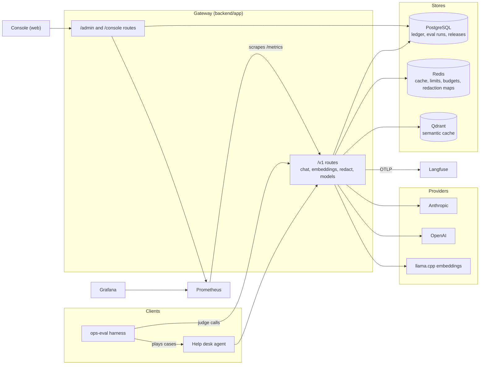
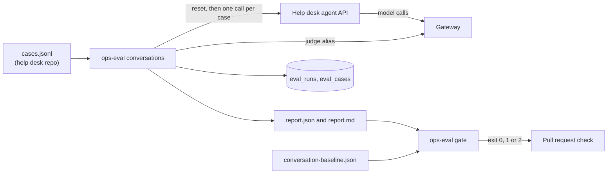

# Architecture

This page explains how the parts fit and why they are shaped this way. For running
it, see [docs/local-setup.md](docs/local-setup.md).

## The parts

- **Gateway.** A FastAPI app in `backend/app/`. Tenants call `/v1/*` with their own
  key. Operators and the console call `/admin/*` and `/console/*` with a separate
  admin key. `/healthz`, `/readyz` and `/metrics` need no key, and the cluster
  ingress keeps `/metrics` off the public port.
- **Console.** A Next.js app in `web/`. Pages render on the server and read only
  through the gateway's `/console/*` routes. The browser never talks to a database
  or to Prometheus.
- **Eval harness.** The `ops-eval` command, in `backend/app/cli/` and
  `backend/app/evals/`. It plays conversation cases against a target, grades them
  through the gateway's `judge` alias, writes a report, and gates it against the
  committed baseline.
- **Stores.** PostgreSQL holds what must last, which is the cost ledger, eval runs
  and releases. Redis holds short-lived shared state. Qdrant holds the semantic
  cache vectors.
- **Monitoring.** Prometheus scrapes the gateway. Grafana shows five dashboards
  and the alert rules. Traces go to Langfuse as OpenTelemetry over OTLP.

## Inside the gateway

`backend/app/` is split by job.

| Folder | What it holds |
|---|---|
| `api/` | the routes, auth checks and the router wiring |
| `services/` | the chat and embedding pipelines, streaming, accounting, console reads |
| `model_routing/` | the policy loader, provider files and the alias resolver |
| `providers/` | one adapter per provider kind, the shared HTTP transport and the circuit breaker |
| `redaction/` | the detectors, placeholder logic, rehydration and the map stores |
| `cache/` | the exact cache key, the Redis cache and the Qdrant semantic cache |
| `limits/` | prices, cost, budgets and rate limits |
| `storage/` | the Postgres pool, the migration runner, the ledger and the console readers |
| `evals/` | conversation cases, checks, the judge, scores, the report and the gate |
| `core/` | settings, typed errors, tracing, metrics and input validation |
| `cli/` | the `ops-migrate`, `ops-eval`, `ops-send-traffic` and `ops-check-console` commands |

The routing, limits and validation code is pure. It does no network calls and
reads no clock of its own, so it is tested with plain objects and held to 100%
coverage.

## One chat request

1. **Auth.** The bearer key is hashed with sha256 and compared with the stored
   digest. `X-Tenant` must match the key, so a caller cannot claim another
   tenant's name.
2. **Context.** `X-Data-Class` sets the data class, and a missing one counts as
   `confidential`. `X-Session`, `X-User` and `X-Prompt-Version` are optional and
   checked for shape. `X-User` must be a random id, never a name or an email.
3. **Routing.** The alias resolves through `backend/config/routing.yaml` to an
   ordered list of provider and model pairs for this tenant.
4. **Redaction.** If the tenant's rule for this data class says redact, every
   message is redacted before anything else sees it.
5. **Limits.** The tenant and user monthly budgets and the per-minute request and
   token limits are checked. A refusal happens before any provider is called.
6. **Cache.** The exact cache is checked first. For an alias with the semantic
   cache on, Qdrant is asked for a stored answer at 0.97 similarity or better.
7. **Provider call.** The first candidate whose circuit is closed is called. A
   failure worth retrying is retried twice with backoff, then the next candidate is
   tried. A circuit opens after 5 failures in 60 seconds and lets a call through
   again after 30. At most 32 provider calls run at once per process.
8. **Accounting.** Tokens, cached prompt tokens included, are priced from the
   provider file's price row in force that day. The ledger row goes on a queue and
   a background worker writes it, so a slow database does not slow the answer. A
   lost connection is retried. A failed commit is not, because the row may already
   be in the table and the money would be counted twice.
9. **Answer.** Placeholders are put back if the caller sent `X-Gateway-Rehydrate`.
   Headers report the provider, model, cost, cache result, whether anything was
   redacted, and the trace id. The trace and the latency metric close after the
   last byte, so a streamed answer is timed in full.

Every refusal is one of a fixed set of error codes, such as `UNAUTHORIZED`,
`TENANT_MISMATCH`, `VALIDATION`, `ALIAS_UNKNOWN`, `RATE_LIMITED`,
`BUDGET_EXCEEDED`, `ALL_PROVIDERS_FAILED` and `PROVIDER_ERROR`. When the caller
should wait, the answer carries `Retry-After`.

## Failure modes, and what happens

| What fails | What the gateway does |
|---|---|
| One provider is down | its circuit opens, and the next candidate in the alias answers |
| Every candidate is down or has no key | 503 `ALL_PROVIDERS_FAILED` |
| Redis is down | the response cache, budget and rate limit reads count as a miss instead of failing the request |
| Qdrant or the embedding server is down | the semantic cache counts as a miss |
| Postgres is slow or down | ledger rows wait in the queue and are retried. A dropped row is counted, and an alert fires |
| Prometheus is not set | console metric fields come back empty, with the source marked `unconfigured` |
| A bad routing or provider file | the gateway does not start, and the error names the file and field. A live reload is refused and the old policy keeps serving |
| An unknown or expired rehydration id | refused before any provider is called |

A gateway with `OPSCONSOLE_ENV` set to anything but `local` refuses to start
without Redis and Qdrant, so a real deployment never runs on the in-process
stand-ins.

## Tenancy

A tenant is a name in `routing.yaml` with its data class rules, budgets, rate
limits and trace settings. The tenant comes from the key, never from the request
body. It is part of every cache key, and the first part of the Redis key each
cache entry is stored under. Redaction maps are read back only by the tenant that
made them. The ledger, traces and metrics all carry the tenant, so cost and errors
can be split per tenant.

## Data kept

| Where | What | How long |
|---|---|---|
| PostgreSQL | ledger rows, eval runs and cases, releases | kept, never rewritten |
| Redis | cache entries, rate limit windows, budgets, redaction maps | redaction maps for one hour. Compose keeps no disk copy |
| Qdrant | semantic cache vectors and answers | until replaced |
| Langfuse | traces, with redacted text only for tenants that turn `trace_content` on | as long as the Langfuse project keeps them |

## Evals

A run resets the target to its seed, plays every case as the case's user, and
checks each turn with three rules. The judge grades each marked reply three times
and the majority wins. The gate exits 0 when every rule clears, 1 when a rule is
breached and 2 when an input cannot be read, so CI can tell a worse run from a
broken one. The full contract is in [docs/eval-target.md](docs/eval-target.md),
[docs/eval-report.md](docs/eval-report.md) and [docs/eval-gate.md](docs/eval-gate.md).

## Where it runs

Locally, `docker-compose.yml` runs everything on one laptop. That is the main path.

The repo also ships deployment code that CI checks but never applies:

- `infra/k8s/` holds kustomize manifests for one small k3s cluster, with
  namespaces, quotas, network policies, the data stores, the apps and the
  monitoring stack. CI builds them, validates them with kubeconform, and deploys
  the gateway to a kind cluster for a smoke test.
- `infra/terraform/hetzner` provisions that one node and its DNS.
- `infra/terraform/aws` is the same platform on EKS with RDS, ElastiCache and S3,
  meant to be applied once and destroyed.
- `infra/terraform/aws-gpu` is one GPU instance for the self-hosted comparison.
- `infra/secrets/` holds example secrets. Real ones are encrypted with SOPS and age.

## Main tradeoffs

- **Config files over a settings page.** Providers, prices and aliases live in
  git, so every change is reviewed and passes the eval gate. The cost is that a
  change needs a commit and a routing reload.
- **Per-process circuit breakers.** Simple, with no shared store. One worker may
  open its breaker a few calls after another, which costs little.
- **Semantic cache on one alias only.** Chat users ask the same thing in different
  words. A judge or an extraction needs the answer to its own exact input, so they
  stay off.
- **One embedding model, no fallback.** A second model would write vectors in a
  different space and silently break search.
- **A real model in the eval gate.** It spends tokens on every pull request, but a
  mock cannot play a conversation, and a gate that cannot fail proves nothing.
