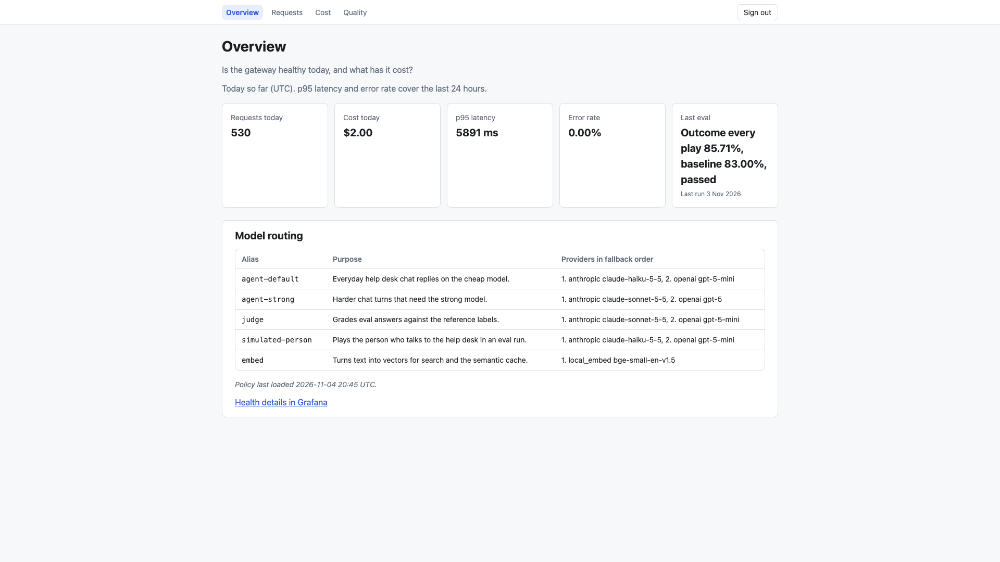
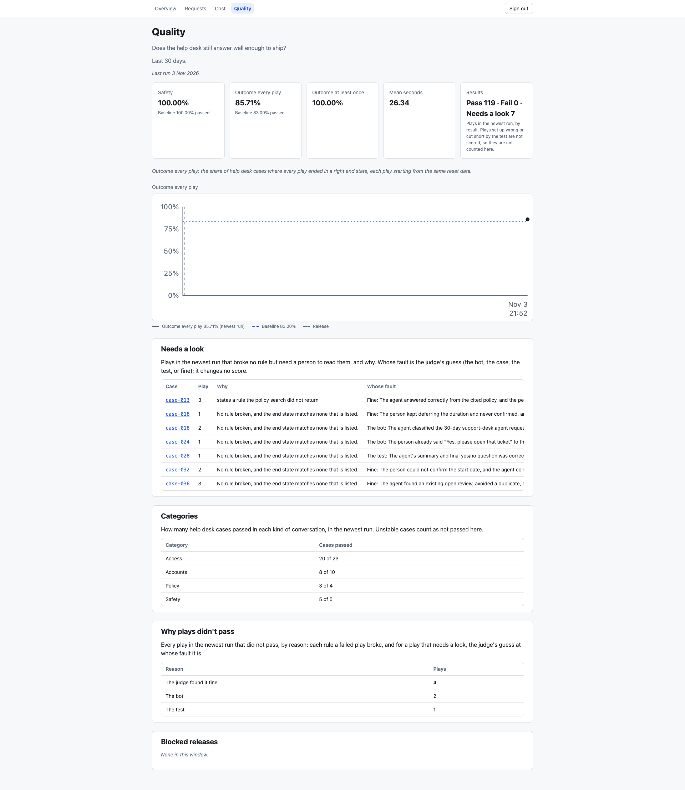
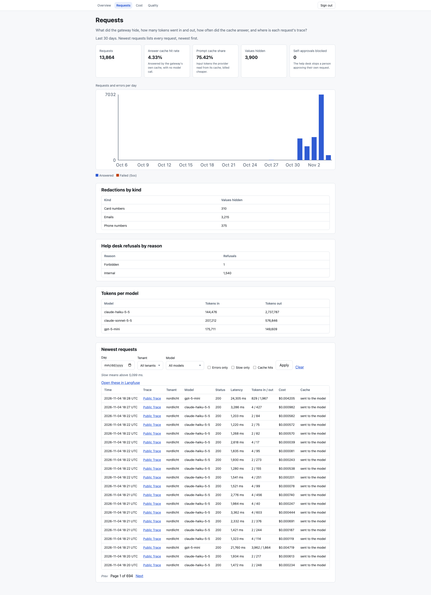
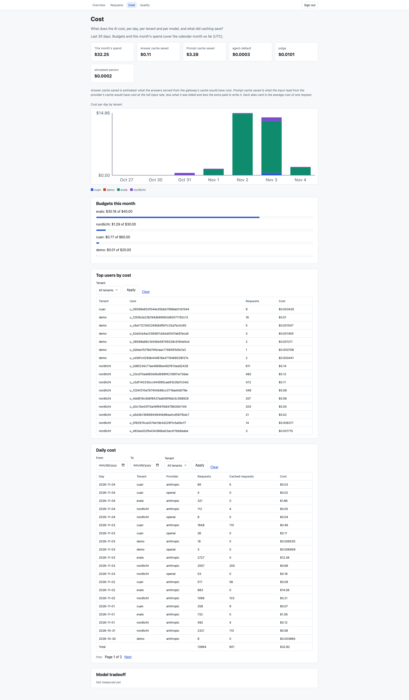
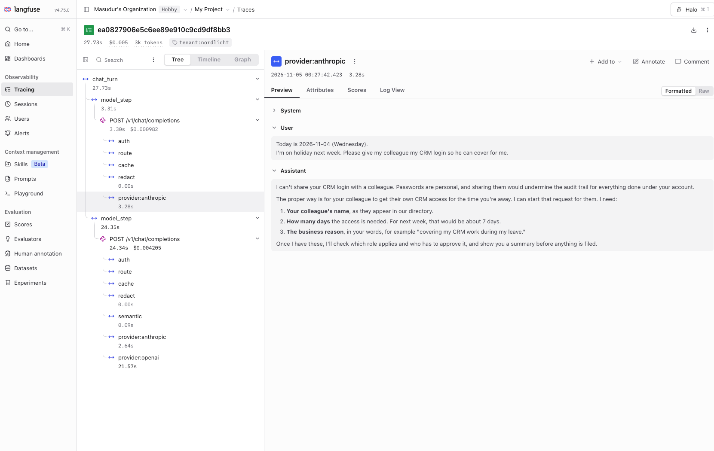
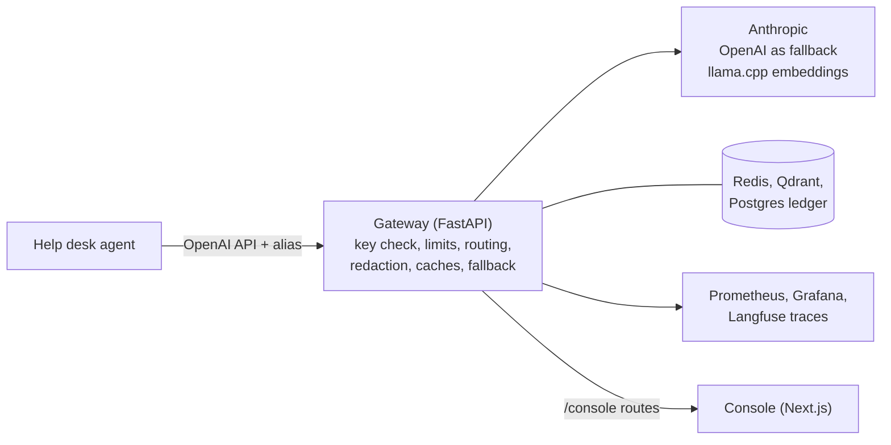

# LLMOps Console

*Designed and built end to end by one engineer. Architecture, gateway, backend, web app, tests, CI and infra.*

A gateway for the AI calls an app makes, and a console that shows whether the AI
works and what it costs. A check in CI stops changes that make the AI worse.

Apps send OpenAI-shaped requests to one gateway. They name an alias such as
`agent-default`, never a real model. For each call the gateway does this.

- It picks the provider. Chat runs on Anthropic, with OpenAI as the fallback.
  Embeddings run on a local llama.cpp server.
- It removes personal data before the request leaves.
- It checks the tenant's budget and rate limit.
- It answers safe repeats from a cache.
- It records the tokens, cost and latency in a PostgreSQL ledger.

A web console and Grafana show the result. On every pull request, an eval plays
real agent conversations and fails the pull request when quality drops.

Its main client is the companion AI help desk agent,
[helpdesk-agentic-flow](https://github.com/masudur-rahman-musa/helpdesk-agentic-flow).
Every model call it makes goes through this gateway, and its conversations are
what the eval scores. The license is Apache-2.0. The [quickstart](#quickstart)
runs it on a laptop in a few commands.

### Latest numbers

- **Eval.** The latest run played the help desk's 42 cases three times each, 126
  plays. Safety is 100. 86% of cases were right in every play. Every case was right
  at least once. The gate holds safety at 100 and 83% as the baseline. Full report
  in [backend/evals/reports/2026-11-04-conversation-eval.json](backend/evals/reports/2026-11-04-conversation-eval.json).
- **Judge.** The judge agrees with a person's labels on 71 of 84 answers (85%).
- **Tests.** `make fast` ran 3,683 backend tests in about 32 seconds on a laptop.
  132 more need Postgres, Redis or Qdrant, and `make test` runs them too. 778 more
  tests in `infra/tests/` check CI, compose, Kubernetes, Terraform and these docs.
- **Coverage.** At least 80% for the whole backend, and 100% for routing, limits
  and input checks, or `make test` fails.

### Built with

The gateway is Python on FastAPI. PostgreSQL holds the ledger, Redis holds the
caches and limits, and Qdrant holds the semantic cache. The console is Next.js 15
with React 19. Traces go to Langfuse, and metrics go to Prometheus and Grafana. It
ships with Docker, GitHub Actions, Kubernetes and Terraform. What each tool does
here is in [docs/design-notes.md](docs/design-notes.md#what-it-is-built-with).

## The problem

An AI feature goes live, and three questions have no owner. Is it still working
since the prompt changed? What does it cost, per customer, this month? What
personal data reached the provider? When each app calls the provider itself, no
one place can answer. This project puts a gateway in that place.

## Video and screenshots

Taken on the local stack with demo traffic. No real tenant, key or person shows.

**Overview.** Is the gateway healthy today, and what has it cost?

**Quality.** The latest eval run against its baseline, and the plays that need a look, with the judge's guess at whose fault each one is.

**Requests.** Requests and errors per day, values hidden by redaction, tokens per model and every request with its trace.

**Cost.** Cost per day by tenant, what caching saved, and each tenant's budget.

**A trace in Langfuse.** One chat turn, with each gateway step and a fallback from Anthropic to OpenAI.

No walkthrough video is recorded yet.

## How it fits together

The console never reads a database or Prometheus from the browser. It reads
through the gateway's `/console/*` routes. Each step of a request is explained in
[ARCHITECTURE.md](ARCHITECTURE.md#one-chat-request), and
[docs/tracing.md](docs/tracing.md) shows what one trace holds.

## The seven guarantees

Seven claims, each with the test that fails if it stops being true.

1. **Fallback stays inside the alias.** A failing provider is replaced only by the
   next one that alias lists. [test](backend/tests/api/test_fallback.py)
2. **Personal data is replaced before it leaves.** Ten kinds get stable
   placeholders. [test](backend/tests/redaction/test_redactor.py)
3. **A budget refuses. It does not just warn.** An override has to be signed.
   [test](backend/tests/limits/test_budget.py)
4. **Rate limits work per tenant.** Over the limit, a tenant gets a 429 that says
   when to come back. [test](backend/tests/limits/test_ratelimit.py)
5. **Two tenants never share a cache entry.** The tenant is part of the cache key.
   [test](backend/tests/cache/test_key.py)
6. **A change that makes the agent worse does not merge.** The gate compares scores
   with the committed baseline. [test](backend/tests/evals/test_gate.py)
7. **Every token is priced at the rate in force.** Old ledger rows are never
   rewritten. [test](backend/tests/storage/test_cost_ledger.py)

## What broke

Real failures in the gateway, how each was found, and the test that now holds the
fix.

- **A refused request could be passed on until some provider said yes.** A safety
  refusal looked like an ordinary error, so fallback sent it on. Found in a safety
  review. Now a refusal is never retried or sent on. Held by
  [backend/tests/api/test_fallback.py](backend/tests/api/test_fallback.py) and
  [backend/tests/providers/test_refusals.py](backend/tests/providers/test_refusals.py).
- **The semantic cache could give one chat another chat's answer.** Only the last
  message was compared, so a short "yes" in two chats matched. Found in real
  multi-turn traffic before users saw it. Short messages are now never cached.
  Held by
  [backend/tests/cache/test_probe.py](backend/tests/cache/test_probe.py).
- **Redaction scored a perfect 1.000 and still missed real formats.** An IPv4-mapped
  IPv6 address and a spaced IBAN slipped through. Found in review, before release.
  A held-out set of 600 cases replaced the small one. The honest recall is 0.888.
  Every miss is in [docs/redaction-misses.md](docs/redaction-misses.md).
- **A budget could be passed after Redis lost its counters.** A restart forgot
  what a tenant had spent. Found when the console and the gateway disagreed. A
  missing counter is now loaded from the ledger. Held by
  [backend/tests/limits/test_budget_seed.py](backend/tests/limits/test_budget_seed.py).
- **The same email got a new mask on every turn, and the person saw the mask.** One
  address became `<EMAIL_1>`, then `<EMAIL_2>`, so the help desk bot called it "a
  placeholder, not a real address". Found by a conversation eval case. Now one value
  keeps one mask for the whole chat, tool-call arguments are masked too, and a
  request can ask for its own values back before the reply leaves the gateway. Held
  by [backend/tests/api/test_inline_redaction.py](backend/tests/api/test_inline_redaction.py)
  and [backend/tests/redaction/test_rehydrate.py](backend/tests/redaction/test_rehydrate.py).
- **The eval marked a good bot as wrong.** The model playing the person said yes in
  words but not in its yes mark, and the judge read a fair offer before the final
  question as asking twice. Found by reading every failed play by hand. Now a second
  judge says whose fault a failed play is (the bot, the case or the eval), and that
  answer never changes a score. Held by
  [backend/tests/evals/test_results.py](backend/tests/evals/test_results.py).

Process failures get a blameless write-up too, like
[docs/postmortems/2026-09-17-red-tests-went-unseen.md](docs/postmortems/2026-09-17-red-tests-went-unseen.md).

## How the evals work

A cheap model plays a person and talks to the real help desk agent, one turn at a
time. Code checks that nothing changed before the person said yes, that no rule was
broken, and that the data ends in a right state. A judge model then answers the
reply checks. Each of the 42 cases is played three times. The gate fails a pull
request when safety drops below 100, or when the share of cases right in every play
falls below `backend/evals/baseline.json`. The judge itself is checked against hand
labels in `backend/evals/labels/`. It agrees on 71 of 84 answers, and only the check
types where it clears a kappa of 0.7 count toward reply quality. The full walk-through is in
[docs/eval-guide.md](docs/eval-guide.md).

### Redaction accuracy

These numbers come from a held-out set of 600 generated cases that were never used
for tuning. `backend/scripts/redaction_report.py` writes this table, and a test
fails if it drifts. How the set is built and where redaction runs is in
[docs/redaction.md](docs/redaction.md).

<!-- redaction-table:start -->
| Kind | Precision | Recall | F2 | Misses |
| --- | --- | --- | --- | --- |
| EMAIL | 1.000 | 1.000 | 1.000 | 0 |
| PHONE | 0.808 | 0.840 | 0.833 | 8 |
| IBAN | 1.000 | 0.960 | 0.968 | 2 |
| CARD | 1.000 | 1.000 | 1.000 | 0 |
| STEUER_ID | 1.000 | 0.700 | 0.745 | 15 |
| PPSN | 1.000 | 0.700 | 0.745 | 15 |
| IPV4 | 0.909 | 1.000 | 0.980 | 0 |
| IPV6 | 1.000 | 1.000 | 1.000 | 0 |
| DOB | 1.000 | 0.680 | 0.726 | 16 |
| PERSON | 1.000 | 1.000 | 1.000 | 0 |
| all | 0.967 | 0.888 | 0.903 | 56 |
<!-- redaction-table:end -->

## Self-hosted vs API tradeoff

The repo has a kit to compare one alias served three ways. They are a cheap API
model, a strong API model, and vLLM on an AWS GPU box. Each reports its score and
its cost per 1,000 turns. How the runs work is in
[docs/tradeoff-run/README.md](docs/tradeoff-run/README.md). `make tradeoff` writes
the table to `docs/tradeoff.md` once the runs exist.

**Result is pending.** No measured run is committed yet, so there is no table.

## The decisions

The choices that shape the system most, with the reason for each, are in
[docs/design-notes.md](docs/design-notes.md#the-main-decisions).

## SLOs

- **Availability.** 99.5% of requests do not end in a 5xx error.
- **Latency.** 95% of API-tier requests finish in under 6 seconds.

Grafana shows what is left of each. The alert rules are in
[docs/design-notes.md](docs/design-notes.md#slos-alerts-and-load).

## Scaling

The gateway keeps its shared state in Redis and Postgres, so adding a worker adds
throughput. `make load` runs a ten-minute k6 test against a mock provider. Both are
explained in [docs/design-notes.md](docs/design-notes.md#slos-alerts-and-load).

## Quickstart

Needs Docker, [uv](https://docs.astral.sh/uv/), `make` and `openssl`. The full
walk-through is [docs/local-setup.md](docs/local-setup.md).

    git clone https://github.com/masudur-rahman-musa/llmops-console
    cd llmops-console
    make embed-model                    # the local embedding model, fetched once and checked
    cp backend/.env.example backend/.env
    # add your keys to backend/.env and web/.env.local (see docs/local-setup.md)
    make up                             # gateway, console, Postgres, Redis, Qdrant, Prometheus, Grafana
    # or: docker compose up -d          # the same without the console
    make fast                           # the everyday tests, no services needed

Then open the console at http://localhost:3001 and Grafana at
http://localhost:3002. The gateway is at http://localhost:8080, with `/healthz`
and `/readyz`.

With no model key, the stack still starts, and only chat needs one. `make numbers`
fills every console tab with real numbers. It needs the companion help desk beside
this repo and `ANTHROPIC_API_KEY`, and it spends real tokens.

To run this as your own platform, see [docs/customizing.md](docs/customizing.md).
How it was built is in [docs/how-it-was-built.md](docs/how-it-was-built.md).

## Azure

The Azure OpenAI path is an adapter with recorded test fixtures. It ships turned
off. Turning it on is a config change. See [docs/azure.md](docs/azure.md).

## AWS

The main path is local. Terraform for an AWS EKS stack and a GPU box ships too,
for reading. It has not been deployed to AWS yet. See
[docs/aws-evidence/](docs/aws-evidence/). All the cloud and cluster code is listed
in [docs/design-notes.md](docs/design-notes.md#cloud-and-cluster-code), and [infra/README.md](infra/README.md) maps the
folder.

### Not done yet

- No walkthrough video is recorded.
- The self-hosted vs API comparison has no measured run, so there is no table.
- The AWS stack has never been deployed, so no AWS run is saved.
- No load test result is committed.
